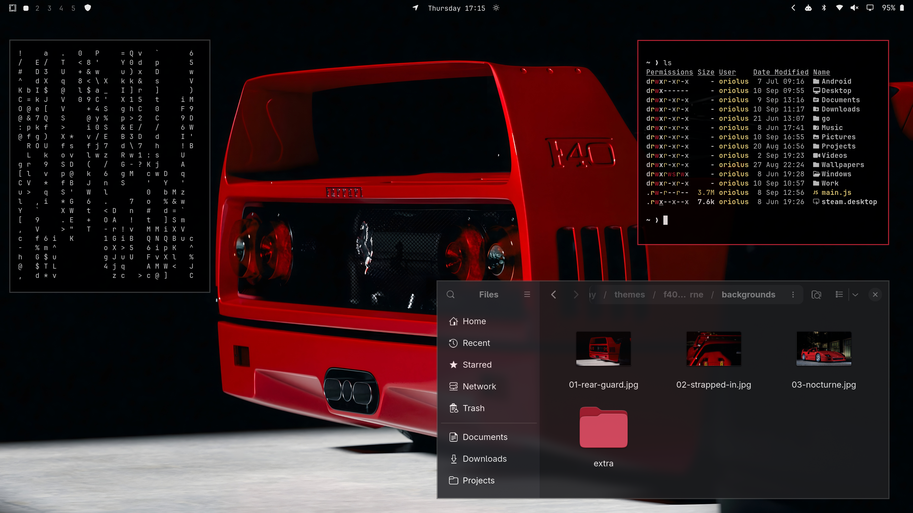
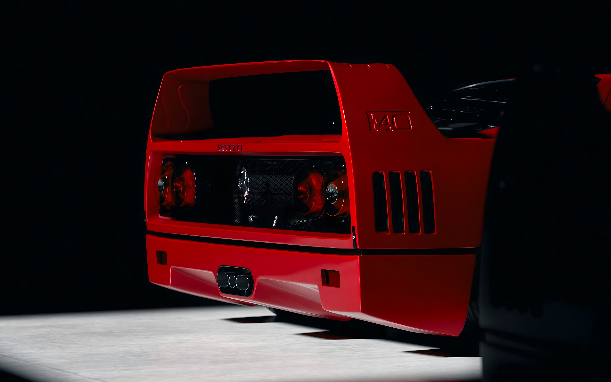
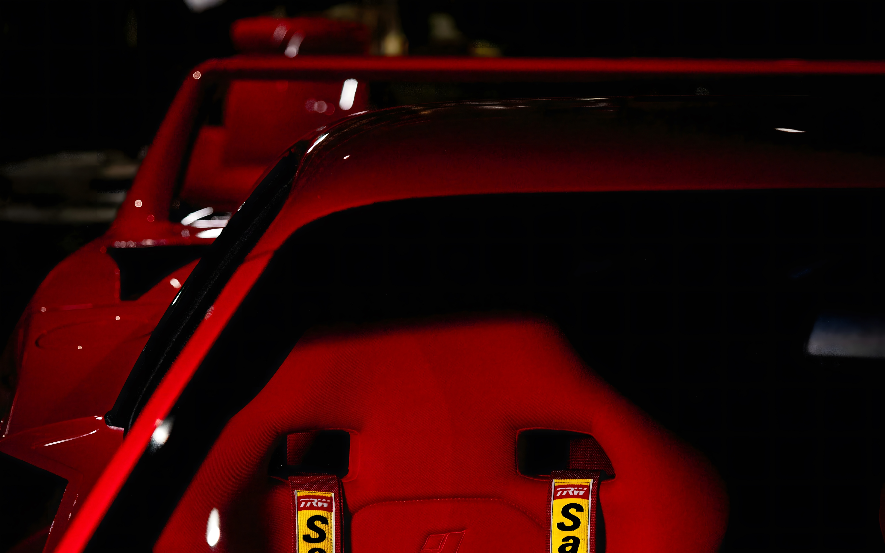
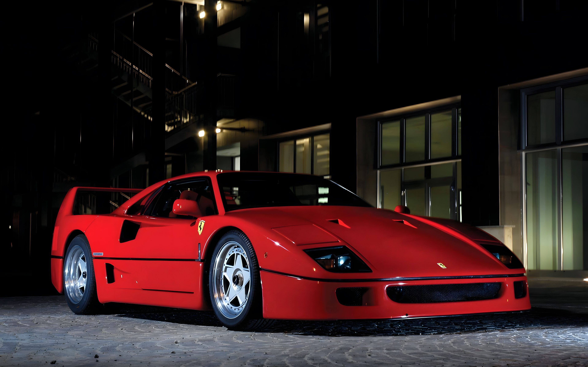
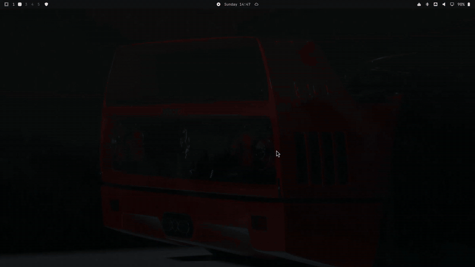

# F40 Nocturne

An **Omarchy** theme inspired by the **Ferrari F40**, the last machine **Enzo Ferrari** put his name on.

Every colour comes from the car and its photos. The ground is **Nero Daytona**, a warm graphite taken from the shadows of the backgrounds instead of pure black. **Rosso Corsa** is matched to the paint as it reads under the studio lights, **Giallo Modena** from the **Cavallino** badge and the Sabelt harness is kept rare, and silver comes from the **Speedline** wheels. The quieter colours come from the backgrounds too: sage and slate from the windows in *Nocturne*, amber from the street lamps.



| Used for | Colour | Hex |
|---|---|---|
| Background | Nero Daytona graphite | `#141213` |
| Text | Warm silver | `#e4dfdb` |
| Accent, borders | Rosso Corsa | `#d8232a` |
| Warnings, user names | Giallo Modena | `#f0c23b` |
| Strings, sizes | Glass sage | `#a5b38b` |
| Functions, folders | Slate | `#8fa4c2` |
| Numbers | Street-lamp amber | `#e8914a` |

## Install

```bash
omarchy theme install https://github.com/oriolescserr/omarchy-f40-nocturne
```

Or **Install → Style → Theme** from the Omarchy menu (`Super + Space`) and
paste the URL.

### Screensaver

Omarchy does not apply theme screensaver branding automatically. To use the included ASCII art:

```bash
cp ~/.config/omarchy/themes/f40-nocturne/screensaver.txt ~/.config/omarchy/branding/screensaver.txt
```

This overwrites any existing screensaver branding.

### Intro sound

Omarchy plays the intro without sound. To hear the engine as well, run this once:

```bash
~/.config/omarchy/themes/f40-nocturne/extras/intro-sound install
```

The sound is on by default. See [Engine sound](#engine-sound) to turn it off or remove it.

## Backgrounds

Images are free of copyright, cropped to fit and upscaled to **3840×2400**. Cycle with `omarchy theme bg next`, or from the Omarchy menu (`Super + Space`) under **Style → Background**.

<table>
  <tr>
    <td align="center" width="33%">
      <br>
      <sub><strong>01 - Rear Guard</strong> (default)<br>Photo by yokatan</sub>
    </td>
    <td align="center" width="33%">
      <br>
      <sub><strong>02 - Strapped In</strong><br>Photo by Stefano Romanello</sub>
    </td>
    <td align="center" width="33%">
      <br>
      <sub><strong>03 - Nocturne</strong><br>Photo credit not found</sub>
    </td>
  </tr>
</table>

## Intro

With the **Rear Guard** background, an 8-second intro plays when you log in and when you switch to this theme. The F40 fades in from black, the engine revs twice, the exhaust puffs, and the engine shuts off. The last frame is the wallpaper itself, so the intro ends without a jump.

<p align="center">
  <br>
</p>

To turn intros off or on (this applies to every theme):

```bash
omarchy theme bg intro disable
omarchy theme bg intro enable
```

### Engine sound

Omarchy always plays intros without sound. This theme ships the engine sound as a separate file, plus a small command called `intro-sound` that plays it in time with the video. Install it with the command under [Intro sound](#intro-sound).

The sound then plays at login and whenever you switch to the theme. To change that later:

| Command | What it does |
|---|---|
| `intro-sound off` | No sound when switching themes |
| `intro-sound on` | Sound again when switching themes |
| `intro-sound off login` | No sound at login |
| `intro-sound off all` | No sound at login or when switching themes |
| `intro-sound on all` | Sound in both cases (the default after install) |
| `intro-sound status` | Show where the sound is on or off |
| `intro-sound uninstall` | Remove the command and everything it added |

The sound follows your system volume and mute. It needs `mpv` and `jq`, which come with Omarchy.

If the sound doesn't play, the last attempt is written to `~/.local/state/omarchy/intro-sound.log`.

<details>
<summary>How it works</summary>

`install` copies the command to `~/.local/bin/intro-sound` and adds two hooks named `90-intro-sound`, one in `~/.config/omarchy/hooks/post-boot.d/` (login) and one in `~/.config/omarchy/hooks/theme-set.d/` (theme switch). When the intro starts, the hook reads the playback position from `owe render-status` and starts the sound at that point with `mpv`, so it stays in sync even if the hook runs late. Right after login the renderer can be too busy to answer, so the hook falls back to the time `owed` logged the intro starting. It plays any `.ogg` that sits next to an intro with the same name (`backgrounds/intros/01-rear-guard.ogg` next to `01-rear-guard.mp4`), so it works for other themes too. `off` and `on` write small flag files to `~/.local/state/omarchy/toggles/`.

</details>

### Credits

Engine sound: [Ferrari start up and drive off](https://freesound.org/people/EwanPenman11/sounds/659560/) by EwanPenman11 on Freesound (CC0), cut into two revs and a shut-off. The exact Ferrari model in the recording is not stated. No freely licensed F40 recording exists.

Exhaust: smoke simulated and rendered in Blender. Only the two outer pipes puff, because the centre pipe is the wastegate outlet and stays shut without boost. The amount of exhaust follows the loudness of the engine sound frame by frame.
